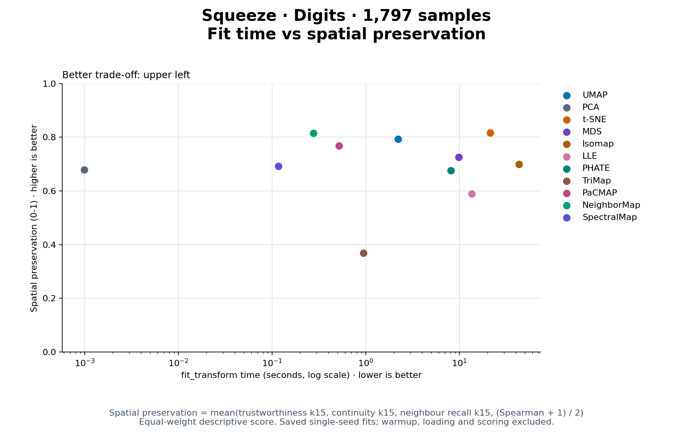
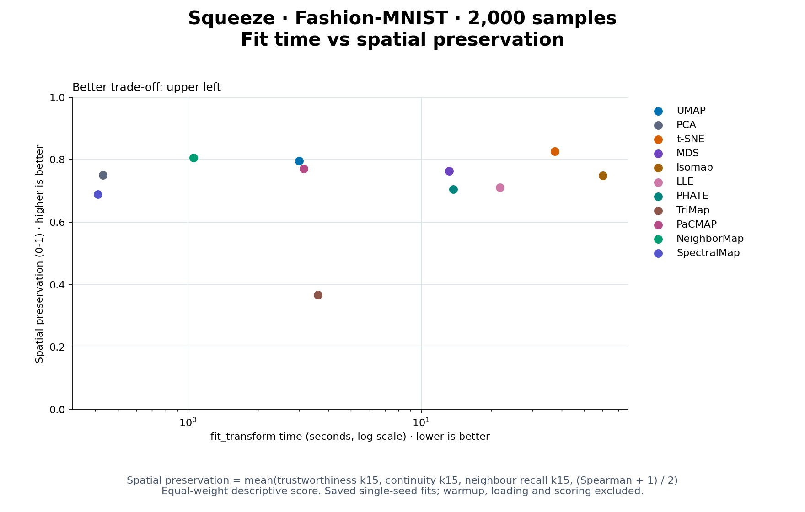
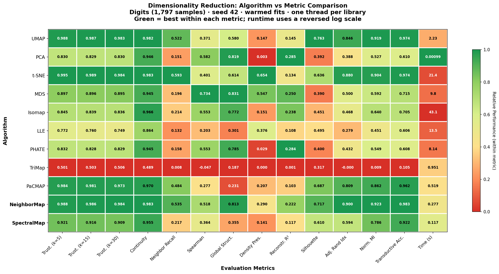
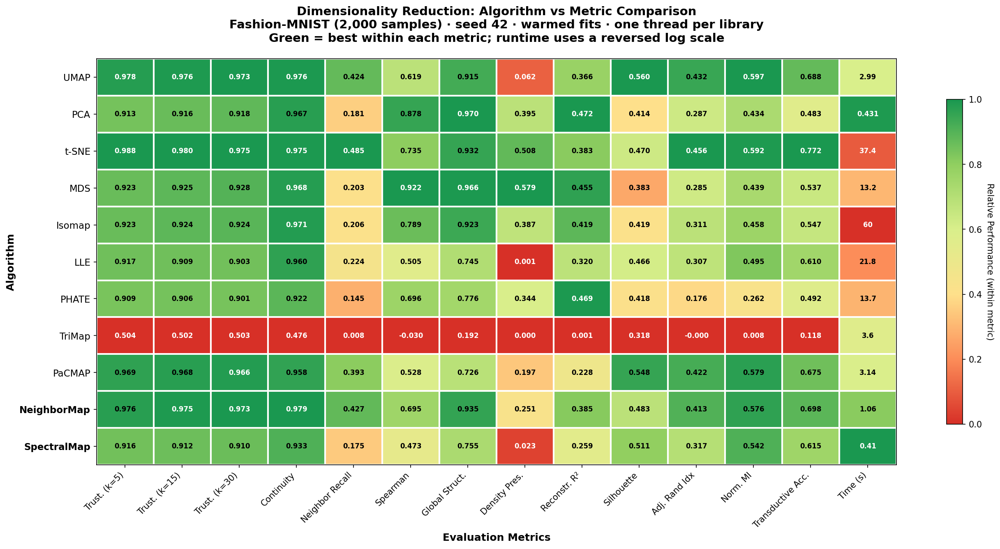

# Benchmark results

The current heatmaps compare **11 algorithms** on Digits and a balanced
2,000-image Fashion-MNIST sample. Both include NeighborMap and SpectralMap.
Each method uses seed 42, one full-data warmup excluded from timing, and a
single thread per numerical library. Time measures `fit_transform`, not scoring.

These are single-seed snapshots. Use the repeated-seed runner below to inspect
variation; no general significance or large-data scalability claim follows from
the heatmaps alone.

## Primary optimisation benchmarks

**Fit speed and embedding quality are primary goals for Squeeze.** Evaluate
algorithm changes against both:

| Benchmark | Measure | Direction |
|---|---|---|
| Fit speed | Wall-clock seconds for the complete `fit_transform` call | Lower is better |
| Embedding quality | Rank trustworthiness, neighbour recall, global distance correlation, cluster separation, and transductive accuracy | Higher is better; inspect each metric separately |

Fit time includes the neighbour search and embedding optimisation performed by
the reducer. Data loading, the full-data warmup, metric scoring, and plotting are
excluded. This is warm fit performance; it does not measure cold-start latency or
the speed of transforming new samples with an already fitted model.

Raw fit seconds are saved as `Time (s)` in the heatmap/radar CSV and `seconds` in
the repeated-seed runner. The heatmaps and radars already include this benchmark;
their reversed log scale makes faster fits greener or farther from the centre.

Compare changes using the same dataset/sample, hardware, thread limits, seeds,
and algorithm parameters. Use [repeated runs](#repeated-seed-comparisons) to
inspect timing variation, and report quality changes alongside speedups. A
faster fit with worse quality is a trade-off to evaluate, not an unconditional
improvement.

## Time to fit

These plots compare saved `fit_transform` time on the horizontal axis with
aggregate spatial preservation on the vertical axis, for all 11 algorithms.
**Upper left is better:** faster fitting with more of the original spatial
relationships retained. Time uses a logarithmic scale; spatial preservation
uses a fixed 0–1 scale.

The spatial score gives equal weight to four measurements:

| Component | What it measures | Weight |
|---|---|---:|
| Trustworthiness, k=15 | Avoiding false neighbours in the embedding | 25% |
| Continuity, k=15 | Avoiding loss of original neighbours | 25% |
| Neighbour recall, k=15 | Retaining the original nearest-neighbour set | 25% |
| `(Spearman + 1) / 2` | Preserving the ordering of pairwise distances, rescaled from −1–1 to 0–1 | 25% |

`Spatial preservation = (trustworthiness + continuity + neighbour recall + (Spearman + 1) / 2) / 4`.

This is a descriptive aggregate of spatial relationships, not a universal
quality score. It excludes fitting time, classification accuracy, and cluster
separation. Its meaning does not change when algorithms are selected or removed;
there is no normalisation against the other algorithms. The component metrics
remain available in the CSVs and quality profiles.

The plots use the same single-seed runs as the heatmaps and radars below, with
one thread per library and one excluded full-data warmup.

### Digits fit time



[SVG](assets/benchmarks/digits-radar/fit_time.svg) ·
[Raw measurements](assets/benchmarks/digits.csv)

### Fashion-MNIST fit time



[SVG](assets/benchmarks/fashion-mnist-radar/fit_time.svg) ·
[Raw measurements](assets/benchmarks/fashion-mnist.csv)

The interactive comparisons below plot the same trade-off for the selected
algorithms, alongside their quality profiles. Hover or focus a point for its
fit seconds and spatial score. Compare methods within each dataset.

## Circular performance profiles

The radar charts show six complementary metrics: rank trustworthiness, neighbor
recall, global distance correlation, cluster separation, transductive accuracy,
and fit speed. **Farther from the centre is better.** Each axis is scaled from the
worst to the best observed result across all 11 algorithms within that dataset;
0 is not zero absolute capability. Speed uses reversed log runtime. Tied axes
sit at 0.5. These relative shapes are not comparable across datasets and polygon
area is not an overall score; exact values remain available in the table.

Select algorithms to overlay below. The axes stay fixed when you change the
selection. Open the standalone chart for a larger view or download the figures.

### Digits radar

<iframe src="../assets/benchmarks/digits-radar/metrics_radar.html" title="Interactive Digits algorithm radar comparison" style="width:100%;height:1050px;border:1px solid #dbe3e8;border-radius:12px" loading="lazy"></iframe>

[Open interactive chart](assets/benchmarks/digits-radar/metrics_radar.html) ·
[PNG](assets/benchmarks/digits-radar/metrics_radar.png) ·
[SVG](assets/benchmarks/digits-radar/metrics_radar.svg)

### Fashion-MNIST radar

<iframe src="../assets/benchmarks/fashion-mnist-radar/metrics_radar.html" title="Interactive Fashion-MNIST algorithm radar comparison" style="width:100%;height:1050px;border:1px solid #dbe3e8;border-radius:12px" loading="lazy"></iframe>

[Open interactive chart](assets/benchmarks/fashion-mnist-radar/metrics_radar.html) ·
[PNG](assets/benchmarks/fashion-mnist-radar/metrics_radar.png) ·
[SVG](assets/benchmarks/fashion-mnist-radar/metrics_radar.svg)

Static figures show one radar per algorithm to keep all 11 profiles readable.
The charts reuse the saved heatmap CSVs; generating them does not rerun any fits.

## Digits · 1,797 × 64



[Download the full Digits CSV](assets/benchmarks/digits.csv)

## Fashion-MNIST · 2,000 × 784



[Download the full Fashion-MNIST CSV](assets/benchmarks/fashion-mnist.csv)

The new method names are bold. Green indicates better performance within a column.
Rank trustworthiness, neighbor recall, and transductive classification accuracy
have different meanings: read the [metric definitions](evaluation_metrics.md)
before comparing them. Sample selection is documented in [Datasets](datasets.md).

## Reproduce the charts

[Build the current extension](installation.md), then run:

```bash
uv run --no-sync python -m scripts.benchmark_metrics_heatmap
uv run --no-sync python -m scripts.benchmark_metrics_heatmap --dataset fashion-mnist --samples 2000
```

Plots and CSVs go to `assets/benchmarks/digits` or
`assets/benchmarks/fashion-mnist`. Embeddings and protocol records go under
`working_docs/heatmap_refresh/<dataset>`. `--output-dir PATH` keeps all output
files together at a custom location. Use `--help` for options.

The benchmark also generates `metrics_radar.png`, `metrics_radar.svg`,
`metrics_radar.html`, `fit_time.png`, and `fit_time.svg` alongside its heatmap.
To redraw the documentation figures
from the saved results without rerunning algorithms:

```bash
uv run --no-sync python -m scripts.benchmark_radar assets/benchmarks/digits/metrics_results.csv --output-dir docs/assets/benchmarks/digits-radar --title "Digits · 1,797 samples"
uv run --no-sync python -m scripts.benchmark_radar assets/benchmarks/fashion-mnist/metrics_results.csv --output-dir docs/assets/benchmarks/fashion-mnist-radar --title "Fashion-MNIST · 2,000 samples"
```

## Repeated-seed comparisons

```bash
OPENBLAS_NUM_THREADS=1 OMP_NUM_THREADS=1 NUMBA_NUM_THREADS=1 RAYON_NUM_THREADS=1 \
uv run --no-sync python -m scripts.benchmark_neighbors \
  --dataset fashion-mnist --samples 2000 --output working_docs/fashion_comparison
uv run --no-sync python -m scripts.report_neighbors working_docs/fashion_comparison
```

Omit the dataset/sample arguments to use Digits. The runner records per-seed
measurements and coordinates; the report provides interactive scatter plots and
runtime/quality comparisons. The Performance Benchmarks GitHub workflow also
offers a dataset selector for manual runs. Pull-request CI uses Digits.

## Evidence and provenance

- [Heatmap protocol and source revision](https://github.com/GeorgePearse/squeeze/blob/main/working_docs/heatmap_refresh/README.md)
- [Saved Digits embeddings and protocol](https://github.com/GeorgePearse/squeeze/blob/main/working_docs/heatmap_refresh/digits)
- [Saved Fashion-MNIST embeddings and protocol](https://github.com/GeorgePearse/squeeze/blob/main/working_docs/heatmap_refresh/fashion-mnist)
- [Earlier three-seed graph comparison](https://github.com/GeorgePearse/squeeze/blob/main/working_docs/neighbor_benchmarks/README.md)

The measured Fashion implementation is retained at commit `99f4935`. Later
output-path and documentation changes do not change its fits or metrics.
Older working reports may label overlap as trustworthiness; their original
measurements are retained as historical evidence, not rewritten as rank scores.
